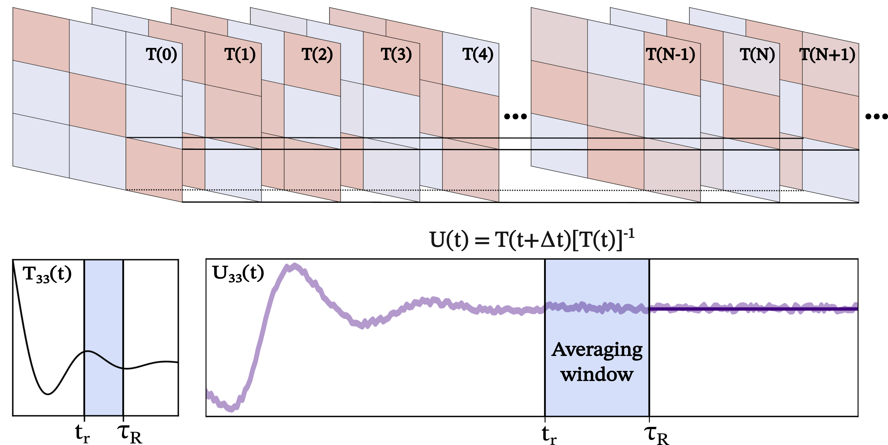

## UGME

Documentation 📚 https://ajdominic.github.io/ugme.github.io/


The `ugme` is a software for building and analyzing time-convolutionless generalized master equation models of biomolecular dynamics. We developed this method to directly include short-time memory effects in reduced dynamical models that recover long-time kinetics from short-time simulations. 



**Overview**

Our U-GME framework provides a way to incorporate non-Markovian effects into reduced dynamical models while retaining a compact description of the dynamics. We further introduce a simple averaging procedure to tame the noise from underconverged correlation matrices.

This repository contains tools for:
- Estimating time-local memory functions from a time-series of transition probability matrices (TPMs), $T(t)$
- Computing the time-local generator $U(t)$ from the $T(t)$
- Characterizing memory plateau $\tau_R$ timescales with the RMSE error metric (in the absence of noise)
- Identifying optimal onset ($t_r$) and offset $(\tau_R)$ of averaging for the time-local propagator $U(t)$
- Propagating the long-time dynamics of the TPMs with the resulting $U_\infty(\delta t) \equiv U(t \geq \tau_R)$.

## Installation Instructions

This package is easily installed in an Anaconda environment or a virtual environment (.venv) via pip. If using a Conda environment, make sure that you have activated it prior to installation. Optional: check that the pip on the Path corresponds to the environment into which you would like to install ``ugme``:

``` bash
which pip
```

Ensure that the path returned by the console is the path to the correct python environment. Next, we'll download and install the package:

``` bash
git clone https://github.com/ajdominic/ugme.github.io.git
pip install <path-to-cloned-repository>
```

## Quick Start
``` python
from ugme import UGME

model = UGME(dt=0.1).fit_fetch("kineticmodel.npy")
tau_R = model.select_tau_R(threshold=0.01)
prediction = model.predict(tau_R)
```

## Associated Publications

The methods and code in this repository were developed in connection with the following publication:

1. Dominic, A. J. III; Sayer, T.; Cao, S.; Markland, T. E.; Huang, X.; Montoya-Castillo, A.  
   **Building insightful, memory-enriched models to capture long-time biochemical processes from short-time simulations.** *Proceedings of the National Academy of Sciences* **2023**, *120* (12), e2221048120.

And a broad discussion of memory effects in biomolecular dynamics can be found in:

2. Dominic, A. J. III; Cao, S.; Huang, X.; Montoya-Castillo, A.  
   **Memory unlocks the future of biomolecular dynamics: Transformative tools to uncover physical insights accurately and efficiently.** *Journal of the American Chemical Society* **2023**, *145* (18), 9916–9927.

## Citation

If you use this repository or adapt the methods in your own work, please cite:

```bibtex
@article{Dominic:2023a,
  title = {Building insightful, memory-enriched models to capture long-time biochemical processes from short-time simulations},
  author = {Anthony J. Dominic III and Thomas Sayer and Siqin Cao and Thomas E. Markland and Xuhui Huang and Andrés Montoya-Castillo},
  journal = {Proceedings of the National Academy of Sciences},
  volume = {120},
  number = {12},
  pages = {e2221048120},
  year = {2023}
}
```

## License

U-GME is distributed under the MIT License. See the [LICENSE](LICENSE) file for details.

